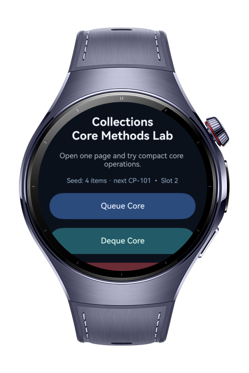
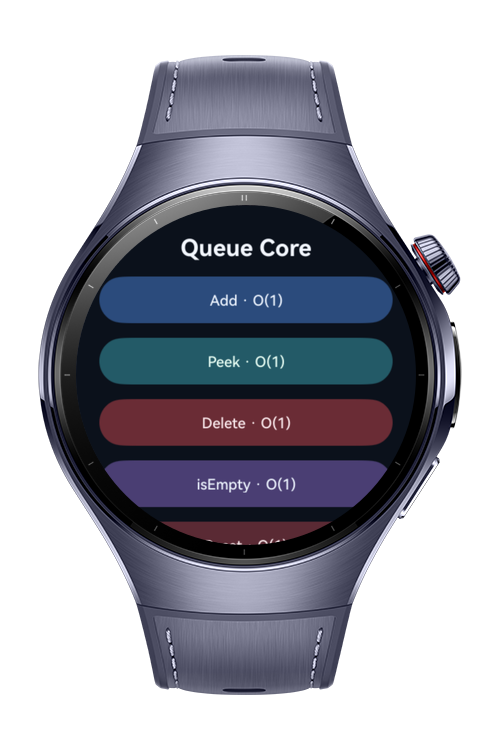

> **Note:** To access all shared projects, get information about environment setup, and view other guides, please visit [Explore-In-HMOS Index](https://github.com/Explore-In-HMOS/hmos-index).

# How to Build Buffered Stream Bench

How to Build Buffered Stream Bench is a HarmonyOS NEXT wearable codelab that demonstrates compact, watch-friendly ArkTS collection operations across queue, deque, stack, list, set, map, array, and bit-flag structures.

# Preview

<div>


</div>

# Use Cases

- Explore core collection operations on small wearable screens with short labels and immediate result feedback.
- Compare queue, deque, and stack behavior through compact action pages.
- Practice indexed collection updates with ArrayList, LinkedList, and List core operations.
- Review dedup and ordered storage behavior with HashSet, LightWeightSet, TreeSet, LightWeightMap, and TreeMap.
- Inspect sparse value and flag-style state updates with PlainArray and BitVector.
- Reset seeded data and repeat the codelab flow without leaving the watch app.

# Feature Surface (Wearable Focus)

- Round-screen-friendly spacing and scroll-safe page layouts.
- Dark-theme-optimized card, text, and button contrast.
- Per-structure pages with compact core method buttons such as Add, Update, Delete, Peek, Has, Get, and Reset.
- Inline result summaries placed near the triggering actions for quick learner feedback.
- Coverage of the requested ArkTS collection modules in one watch-first teaching sample.

# Tech Stack

Languages: ArkTS
Frameworks: HarmonyOS SDK 6.0.1(21)
Tools: DevEco Studio / hvigor build flow
Libraries/Kits: `@kit.ArkUI`, `@kit.AbilityKit`, `@kit.ArkTS`, `@ohos.hypium`

# Directory Structure

```
entry/src/main/ets/
|---components
|---|---StatCard.ets
|---data
|---|---CheckpointSeedData.ets
|---entryability
|---|---EntryAbility.ets
|---entrybackupability
|---|---EntryBackupAbility.ets
|---models
|---|---CheckpointModels.ets
|---pages
|---|---ArrayListAddPage.ets
|---|---BitVectorSetAllBitsPage.ets
|---|---DequePage.ets
|---|---HashSetAddPage.ets
|---|---Index.ets
|---|---LightWeightMapSetPage.ets
|---|---LightWeightSetAddPage.ets
|---|---LinkedListListSetPage.ets
|---|---PlainArraySetValueAtPage.ets
|---|---QueuePage.ets
|---|---StackPage.ets
|---|---TreeMapSetPage.ets
|---|---TreeSetAddPage.ets
|---services
|---|---CheckpointBoardService.ets
```

# Constraints and Restrictions

## Supported Devices

- Huawei Watch 5

# LICENSE

How to Build Buffered Stream Bench is distributed under the terms of the MIT License.
See the [LICENSE](/LICENSE) for more information.
